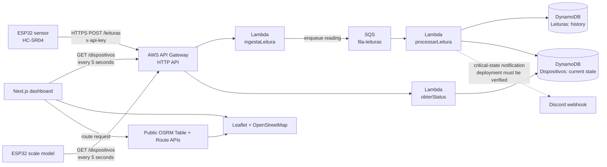

# System architecture

Sentinelas demonstrates a small monitoring pipeline for public drains and waste bins. The sensor sends measurements, AWS processes and stores them, and the dashboard and physical scale model read the latest device state.

## End-to-end data flow

`POST /leituras` returns after the reading is accepted for asynchronous processing; it does not mean that both DynamoDB writes have finished. `GET /dispositivos` reads the current-state table and returns a JSON array. Neither the browser nor the scale model accesses DynamoDB directly.

## Sensor cycle

The current sensor sketch collects 12 HC-SR04 samples, rejects echoes outside the configured physical range, selects a consistent group of readings, and uses its median with a temporal smoothing step. It maps the calibrated empty/full distances to an estimated occupancy from 0 to 100 percent, then sends a JSON reading every two seconds. Invalid measurement cycles are not sent.

`DISTANCIA_VAZIO_CM` and `DISTANCIA_CHEIO_CM` are physical calibration values for the container, not universal constants. `bateria` is currently a demonstration value of 100; the prototype does not measure battery voltage.

## AWS responsibilities

| Component | Responsibility |
|---|---|
| API Gateway HTTP API | Exposes the ingestion and current-device routes. |
| `ingestaLeitura` | Checks the `x-api-key` and required payload fields, then sends a message to SQS. |
| `fila-leituras` | Decouples HTTP intake from processing and allows retries. SQS provides at-least-once delivery; processing must tolerate duplicates. |
| `processarLeitura` | Classifies occupancy (`ok` below 60%, `atencao` from 60% to below 80%, `critico` at 80% or above) and updates the history and current-state tables. |
| `obterStatus` | Reads `Dispositivos` and returns the current records to clients. |
| DynamoDB `Leituras` | Stores reading history, keyed by device ID and timestamp. |
| DynamoDB `Dispositivos` | Stores the latest state and static map metadata such as name and coordinates. |

The Discord notification is part of the documented target flow, but its current deployed configuration has not been verified in this repository. See [AWS backend](aws-backend.md) for the distinction between recorded setup and verified behavior.

## Data model

`Dispositivos` uses `id_dispositivo` (String) as its partition key. A record includes the display name, device type, `lat`, `long`, current occupancy, distance, battery value, status, and `ultima_leitura` in Unix milliseconds. Coordinates and names are administrative metadata; the sensor does not send them in its reading.

`Leituras` uses `id_dispositivo` (String) as its partition key and `timestamp` (Number, milliseconds) as its sort key. The dashboard currently consumes only the latest-state endpoint; it does not display the historical table.

## Dashboard and map

The browser polls `GET /dispositivos` every five seconds. The device list and alert view represent current state, not a persistent alert history. The map uses valid `lat`/`long` values from each device record. Its basemap is OpenStreetMap; the optional route is calculated in the browser with the public OSRM Table and Route services.

The browser asks for geolocation only after the user selects the location control on the map. The position remains in page memory, is not sent to AWS, and is not stored in a cookie.

The route includes every device with valid coordinates. If the UniMAX maintenance base is selected, it is the origin. Otherwise, the browser's granted location is used when available; without it, the origin falls back to UniMAX. Critical devices are prioritized only if the estimated travel time does not increase. This is a demonstration heuristic, not a traffic-aware or guaranteed optimal dispatch route.

The scale model independently polls the same GET endpoint, finds the configured `ID_DESTINO` (currently `lixeira_01`), and alternates its route LEDs while that device reports `critico`. It does not receive commands from the dashboard and does not calculate a street route.

## Security and deployment boundary

- The ingestion API key belongs only to the sensor's ignored local config and the AWS ingestion function. It must never be placed in the dashboard bundle.
- The status GET is currently consumed directly by the browser and scale model without an API key. Treat returned device data as public.
- Firmware secrets are stored in local `config.local.h` files and must not be committed.
- The firmware sketches currently call `setInsecure()`. This keeps HTTPS encryption but disables server-certificate identity validation; it is for the controlled classroom prototype only.
- AWS Lambda source and infrastructure configuration are not yet checked into this repository. The AWS Console is currently the source of truth for deployed resources.
