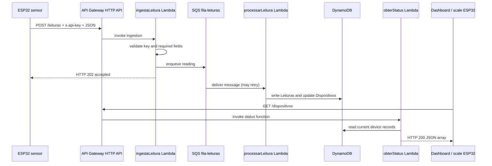

# AWS backend

This page is the repository's reference for the AWS resources and API contracts used by Sentinelas. Resource names and the last end-to-end result below come from the team's project records. The AWS account was not queried while preparing this document, so confirm the live Console state before changing or redeploying a function.

## Recorded environment

| Resource | Recorded value / role |
|---|---|
| Region | `sa-east-1` (South America, São Paulo) |
| API | API Gateway HTTP API, `sentinelas-api` |
| API base URL | `https://e5rd5fpsvh.execute-api.sa-east-1.amazonaws.com` |
| Ingestion route | `POST /leituras` → Lambda `ingestaLeitura` |
| Status route | `GET /dispositivos` → Lambda `obterStatus` |
| Queue | SQS `fila-leituras` |
| Optional dead-letter queue | `fila-leituras-dlq` (the project record marks this optional; verify whether it exists) |
| Processing function | Lambda `processarLeitura`, invoked by SQS |
| DynamoDB tables | `Dispositivos` and `Leituras` |

The last recorded end-to-end test was on September 18, 2026: a reading with 65% occupancy was accepted, processed through SQS, stored, and returned by the status endpoint as `atencao`. This is a historical test record, not a live health check.

The Lambda source code and AWS infrastructure definition are not currently in this Git repository. No Terraform, AWS SAM, or CDK template is included. The functions are managed in the AWS Console, so their live code, environment variables, permissions, triggers, CORS settings, and queue retry configuration cannot be reproduced from a clone yet. Do not upload code from this repository over a live function until the current Console version has been exported and reviewed.

## Request and response flow



`202 Accepted` means the ingestion step queued the message; it does not guarantee that processing or persistence has completed. SQS uses at-least-once delivery, so the processing function should be safe to retry and should not create duplicate history or let older readings overwrite newer state.

## API contracts

### `POST /leituras`

Full URL:

```text
https://e5rd5fpsvh.execute-api.sa-east-1.amazonaws.com/leituras
```

Headers:

```text
Content-Type: application/json
x-api-key: <the local ingestion key>
```

Example body:

```json
{
  "id_dispositivo": "lixeira_01",
  "tipo": "lixeira",
  "nivel_ocupacao": 43.5,
  "distancia_cm": 20.0,
  "bateria": 100
}
```

The key is validated by `ingestaLeitura` according to the project record. Do not put it in this document, Git, screenshots, the frontend, or a `NEXT_PUBLIC_*` variable. The ESP32 sketch reads it from the ignored `firmware/esp32-sensor/config.local.h` file.

The sensor sends the ID, type, occupancy, distance, and battery value. The Lambda assigns a timestamp for persistence. Device name and coordinates are maintained in `Dispositivos`, not sent by the sensor.

### `GET /dispositivos`

Full URL:

```text
https://e5rd5fpsvh.execute-api.sa-east-1.amazonaws.com/dispositivos
```

The dashboard and scale ESP32 call this route without an API key. It returns an array of current device records, for example:

```json
[
  {
    "id_dispositivo": "lixeira_01",
    "nome": "Demo waste bin",
    "tipo": "lixeira",
    "lat": -23.09,
    "long": -47.22,
    "nivel_ocupacao": 43.5,
    "distancia_cm": 20.0,
    "bateria": 100,
    "status_atual": "ok",
    "ultima_leitura": 1792804578992
  }
]
```

`ultima_leitura` is Unix time in milliseconds. `long` is the API field name for longitude. A record without valid numeric coordinates remains available to the device list but is omitted from the map and route. Since this route is unauthenticated, do not store sensitive or personally identifying information in device records.

## DynamoDB model

| Table | Partition key | Sort key | Purpose |
|---|---|---|---|
| `Dispositivos` | `id_dispositivo` (String) | — | Static metadata plus the latest reading and computed status. |
| `Leituras` | `id_dispositivo` (String) | `timestamp` (Number, milliseconds) | Historical readings per device. |

The current-state endpoint reads `Dispositivos`; the dashboard does not query `Leituras`. The project record describes `obterStatus` as scanning the current-state table, which is sufficient for the small academic prototype but should be revisited if the number of devices grows.

## Lambda and queue responsibilities

- **`ingestaLeitura`:** validate JSON, required fields, numeric bounds, and `x-api-key`; send the accepted reading to `fila-leituras`. Keep the API key in a server-side Lambda environment variable, never in logs.
- **`processarLeitura`:** derive status from the configured thresholds (`ok` < 60%, `atencao` ≥ 60% and < 80%, `critico` ≥ 80%); persist history; update the latest-state record. Treat a repeated SQS message as a retry, not a new sensor reading.
- **`obterStatus`:** return the current-state records as JSON and configure CORS for the exact dashboard origins.
- **Discord:** a critical-state webhook appears in the intended design. Its currently deployed status and retry behavior are not verified in this repository.
- **SQS/DLQ:** `fila-leituras` is part of the recorded pipeline. The dead-letter queue is optional in the notes; verify its actual existence, redrive policy, and `maxReceiveCount` in the Console.

Each Lambda should use its own execution role with only the actions it needs: ingestion sends messages to SQS; processing consumes SQS and reads/writes the two tables; status reads `Dispositivos`. Confirm the actual policies in IAM before relying on these expectations.

## Test from PowerShell

Set the API base URL and a local key without saving the key in the repository:

```powershell
$env:SENTINELAS_API_BASE_URL = "https://e5rd5fpsvh.execute-api.sa-east-1.amazonaws.com"
$env:SENTINELAS_API_KEY = "XXXX"

$reading = @{
  id_dispositivo = "lixeira_01"
  tipo = "lixeira"
  nivel_ocupacao = 43.5
  distancia_cm = 20.0
  bateria = 100
} | ConvertTo-Json

Invoke-RestMethod `
  -Method Post `
  -Uri "$($env:SENTINELAS_API_BASE_URL)/leituras" `
  -Headers @{ "x-api-key" = $env:SENTINELAS_API_KEY } `
  -ContentType "application/json" `
  -Body $reading

Invoke-RestMethod -Method Get -Uri "$($env:SENTINELAS_API_BASE_URL)/dispositivos"
```

Replace `XXXX` in the current PowerShell session with the actual key. The example value is deliberately invalid. Check the HTTP response, then verify the asynchronous path in the AWS Console: **API Gateway → sentinelas-api → Routes**, **Lambda → Monitor / CloudWatch logs**, **SQS → fila-leituras → Monitoring**, and **DynamoDB → Dispositivos / Leituras → Explore table items**. The queue message may disappear quickly when the consumer is working. The final check is the updated JSON from `GET /dispositivos`.

## Console checks before a presentation

Select `sa-east-1`, then confirm:

1. Both API routes exist and point to the expected Lambda functions.
2. The deployed Lambda functions, runtime, environment variables, execution roles, and triggers match this document.
3. `processarLeitura` is subscribed to `fila-leituras`; check the DLQ separately if one was created.
4. DynamoDB table names and keys match the model above.
5. HTTP API CORS allows the local dashboard origin and the actual deployed site origin for `GET`.
6. The `GET /dispositivos` response contains the test device and its expected coordinates/status.

Do not commit or publish API keys, webhook URLs, AWS credentials, or local firmware configs. The API key shown as `XXXX` is a placeholder, not a working credential.
